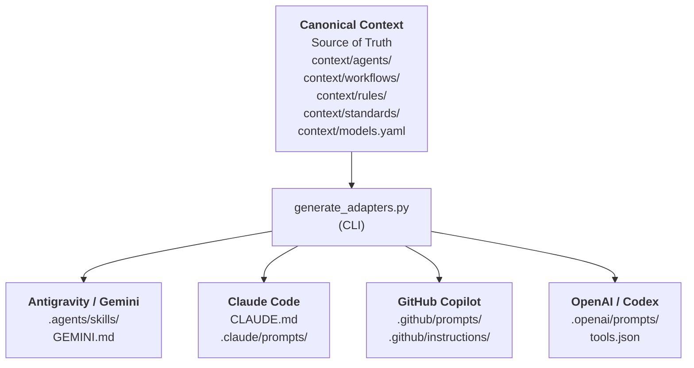
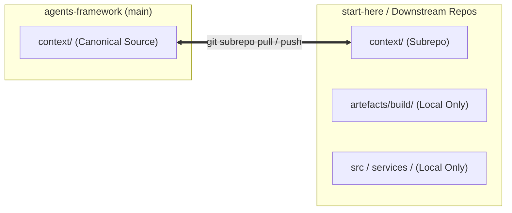

# Agent Harness

Agentic Orchestration Harness runtime adapter generator and drift validator

---

## Quick Deployment

### 0. Environment Variables (`.env` + `direnv`)

`.env` is **not committed to Git** — `.gitignore` ignores `.env` and `.env.*`, and only re-admits the template. A fresh clone therefore has no environment configuration at all. Copy it across from a local `start-here` checkout:

```bash
cp /path/to/local/start-here/.env .env
```

If you do not have a local checkout to copy from, seed it from the committed template and populate the values:

```bash
cp .env.template .env
```

`direnv` loads `.env` into your shell automatically whenever you `cd` into the repository — see [Environment Variables (`direnv`)](#environment-variables-direnv) for the one-time `direnv allow` setup.

### 1. One-Step Initialisation & Refresh (`init.sh`)

When seeding a new project from `start-here` or freshening the current repository:

```bash
./init.sh
```

`init.sh` interactively:
- Prompts for project metadata (`pyproject.toml` name/description)
- Configures target AI coding runtimes (Gemini/Antigravity, Claude Code, GitHub Copilot, OpenAI/Codex) and prunes unselected projections
- Syncs or clones standard subrepositories (`context/`, and optionally `typst/` for PDF typesetting)
- Regenerates adapter projections and updates lockfiles (`uv.lock`)
- Sets up `.pre-commit-config.yaml` and activates git hooks

You can also run non-interactively with CLI flags:

```bash
# Non-interactive with all defaults
./init.sh -y

# Configure specific runtimes with Typst
./init.sh -r claude,gemini -t -y

# View all options
./init.sh -h
```

### 2. Manual Setup (Alternative)

If you prefer manual file copying instead of using `init.sh`:

```bash
# Copy context directory and orchestration guide
cp -r context/ /path/to/your-project/context/
cp CLAUDE.md /path/to/your-project/CLAUDE.md
cp AGENTS.md /path/to/your-project/AGENTS.md
```

### 2a. Configure MCP (Optional)

```bash
# Claude Code CLI
cp context/mcp/mcp.json ~/.claude/mcp.json

# Claude Desktop
# macOS: ~/Library/Application Support/Claude/claude_desktop_config.json
# Windows: %APPDATA%\Claude\claude_desktop_config.json
# Linux: ~/.config/Claude/claude_desktop_config.json

# Cursor IDE
cp context/mcp/mcp.json /path/to/your-project/.mcp.json
```

### 3. Generate Runtime Adapters

```bash
cd /path/to/your-project
# Smart update all projections (Gemini, Claude Code, Copilot, Codex)
uv run python context/scripts/generators/generate_adapters.py

# Or generate for a specific runtime
uv run python context/scripts/generators/generate_adapters.py -t claude
```

### 4. Create Artefacts Structure

```bash
mkdir -p artefacts/{product,architecture,design,build,test-results,shared}
mkdir -p artefacts/shared/{handoffs,fixtures,mocks}
```

---

## Environment Variables (`direnv`)

Environment variables are loaded into any interactive terminal with [`direnv`](https://direnv.net/). The committed `.envrc` contains only two directives:

```bash
layout uv   # ensure .venv exists and is on PATH (runs uv sync --frozen)
dotenv      # load ./.env into the shell environment
```

On entering the repository, `direnv` evaluates `.envrc`, exports every key in `.env` (`UPSTREAM_PUSH_TOKEN`, `SUPABASE_URL`, `SUPABASE_ANON_KEY`, `SUPABASE_SERVICE_ROLE_KEY`, `SUPABASE_DB_PASSWORD`, `ANTHROPIC_API_KEY`, `OPENAI_API_KEY`, `GEMINI_API_KEY`, …) and puts the project virtualenv on `PATH`. On leaving, it unloads them again, so neighbouring projects and global shells are unaffected:

```
direnv: loading ~/Repos/start-here/.envrc
direnv: export +ANTHROPIC_API_KEY +GEMINI_API_KEY +OPENAI_API_KEY +SUPABASE_URL ...
```

Because `.env` is git-ignored, this file is the only thing that ever lands in version control — secrets stay local. `.env.template` documents the expected keys; see step 0 of [Quick Deployment](#0-environment-variables-envdiren).

### One-time setup

```bash
# Install direnv (macOS)
brew install direnv

# Wire up the shell hook — zsh shown; bash/fish hooks: https://direnv.net/docs/hook.html
echo 'eval "$(direnv hook zsh)"' >> ~/.zshrc
exec zsh
```

```bash
# From the repository root: trust .envrc once (repeat whenever .envrc changes)
direnv allow
```

Without the hook, `.envrc` is never evaluated and no variables are exported. Without `direnv allow`, direnv refuses to run the file and prints a blocked-status warning.

### Verifying and troubleshooting

```bash
direnv status            # shows allow status, loaded .envrc, and .env location
echo "$SUPABASE_URL"     # should print your local value, not an empty string
direnv reload            # re-apply after editing .env or .envrc
direnv deny              # revoke trust if you need to inspect .envrc changes
```

If variables are missing, check that you are in a **new** shell (the `eval` hook only applies to shells started after it was added) and that `.env` actually exists. With `.env` absent, `dotenv` fails the load with `.env at /path/to/.env not found`, so no keys are exported.

`direnv` watches `.env`, `.envrc`, `pyproject.toml`, `uv.lock`, and `.python-version`, so editing any of them reloads the environment on your next prompt (`direnv reload` forces it immediately).

---

## Runtime Adapters & Architecture

This framework employs a **Hexagonal (Ports and Adapters)** architecture to ensure cross-platform portability across AI coding runtimes.



### Core Non-Functional Requirements (NFRs)

1. **Autonomy**: Each projection provides self-contained context and tool contracts tailored to the target platform, enabling autonomous agent loops and subagent spawning without human intervention.
2. **Token Efficiency**: Scoped projection instructions and selective includes ensure agent context windows are never polluted with irrelevant guidelines. Model tiers (`small`, `medium`, `large`) route tasks to cost-effective models via `models.yaml`. Smart generation (`--new`) only writes modified files, preventing file-watcher and cache churn.
3. **Intent Preservation**: The canonical definition in `context/` acts as the single source of truth. Projections are deterministic transformations ensuring consistent engineering standards across all AI tools.

### CLI Usage (`generate_adapters.py`)

```bash
# Smart update: write only changed or new files (default)
uv run python context/scripts/generators/generate_adapters.py

# Force full regeneration of all files
uv run python context/scripts/generators/generate_adapters.py -a

# Dry-run: preview files that would be modified without writing to disk
uv run python context/scripts/generators/generate_adapters.py -d

# Target filtering with convenience shortcuts
uv run python context/scripts/generators/generate_adapters.py -g          # Gemini / Antigravity
uv run python context/scripts/generators/generate_adapters.py -c          # Claude Code
uv run python context/scripts/generators/generate_adapters.py -p          # GitHub Copilot
uv run python context/scripts/generators/generate_adapters.py -o          # OpenAI / Codex
```

### Automated Drift Enforcement (`adapter_drift.py`)

To prevent divergence between canonical context files and generated adapter projections, an automated drift validator runs during pre-commit checks:

```bash
uv run python context/scripts/validators/adapter_drift.py
```

If any generated projection is missing, manually edited, or out of date, the validator fails with exit code `1` and actionable remediation instructions.

---

## Framework Distribution & Downstream Integration

The framework distributes canonical context from the dedicated [`agents-framework`](https://github.com/Schmoiger/agents-framework) repository (`main` branch) as an isolated, self-contained directory (`context/`). Downstream repositories (including `start-here`) import standards, workflows, and agents without inheriting project-specific state (`artefacts/build/`, `artefacts/product/`, or application code).

Bi-directional synchronisation is managed via `git-subrepo`:




### Quick Commands for Downstream Projects

```bash
# 1. Adopt standards into a new or existing repository
PATH="/opt/homebrew/bin:/usr/local/bin:$PATH" git subrepo clone https://github.com/Schmoiger/agents-framework.git context -b main

# 2. Re-compile runtime adapter projections after pulling upstream updates
PATH="/opt/homebrew/bin:/usr/local/bin:$PATH" git subrepo pull context
uv run python context/scripts/generators/generate_adapters.py

# 3. Push local standards improvements back upstream
uv run python context/scripts/validators/adapter_drift.py
PATH="/opt/homebrew/bin:/usr/local/bin:$PATH" git subrepo push context
```

For complete setup instructions and pre-commit hook configuration, see [`context/README.md`](context/README.md#downstream-integration--standards-synchronisation-git-subrepo).

---

## Documentation

- **Getting started**: See `context/README.md` - Complete guide for agents and humans
- **Workflow guide**: See `AGENTS.md` / `CLAUDE.md` - Auto-generated orchestration guides
- **Agent reference**: See `context/agents/` - Individual agent definitions
- **Standards**: See `context/standards/` - Coding, testing, tech stack guidance
- **Workflows**: See `context/workflows/` - Structured delivery pipelines (TDD, design, prototype, content, deploy, bugfix)
- **Validators**: See `context/scripts/validators/README.md` - Pre-commit consistency validators

---

## What's Included

- **19 specialised agents** - Discovery, architecture, coding, review, testing, deployment, workflow analysis, tokenomics
- **14 standards** - Coding, testing, architecture, tech stack, documentation, security
- **18 rules** - Enforceable constraints with automated validators
- **8 workflows** - Including build (Detroit TDD), design, prototype, content, deploy, bugfix, full-test, and continuous-improvement (incident + retrospective modes)
- **4 runtime adapters** - Antigravity/Gemini, Claude Code, GitHub Copilot, OpenAI/Codex
- **1 unified generator CLI** - Deterministic compilation with smart change detection and drift prevention
