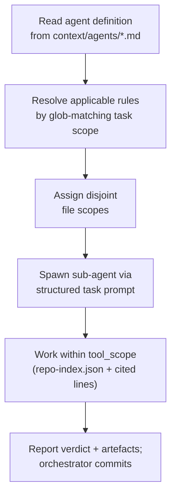
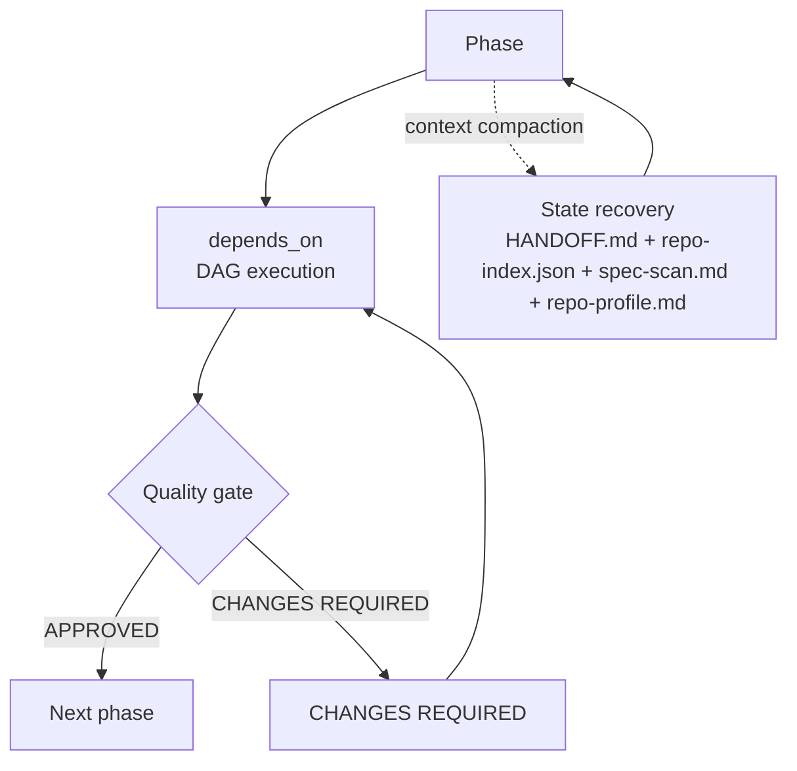

# Architecture: Agentic Orchestration Harness (Derived)

---

## System Overview

**Confidence**: Verified · 90% · Evidence: context/scripts/code-specs/spec_indexer.py:2015-2092, context/scripts/generators/generate_adapters.py:428, context/workflows/*.yaml (11 workflows), context/agents/*.md (34 agents)

The Agentic Orchestration Harness is a vendor-neutral, portable multi-agent coordination framework that decouples engineering workflows, rules, and agent definitions from specific LLM runtimes.

Core architectural properties:
- Canonical Core: context/ (agents, rules, standards, workflows, templates, persona) — never rewritten by derive-spec
- Runtime Adapters: Generated projections for Claude Code, Cline, Gemini, Copilot, Codex
- 34 agents across 11 workflows with phase-gated execution
- Disk-durable state: HANDOFF.md, tasks.md, repo-index.json survive context compaction
- Rules/Standards split: binary rules (<200 tokens) + reference standards (2000-5000 tokens)

---

## Component Architecture

**Confidence**: Verified · 85% · Evidence: artefacts/build/derived-spec-working/repo-index.json:452 (files inventory, 731 symbols), context/scripts/generators/, context/scripts/validators/, context/workflows/

| Component | Purpose | Key Files |
|-----------|---------|-----------|
| Spec Indexer | Deterministic extraction (scan/verify) | context/scripts/code-specs/spec_indexer.py |
| Adapter Generators | Runtime projections (5 targets) | context/scripts/generators/adapters/*/generator.py |
| Validator Suite | 11 pre-commit/CLI validators | context/scripts/validators/*.py |
| Workflow Engine | 11 YAML workflows + README | context/workflows/*.yaml, context/workflows/README.md |
| Agent Definitions | 34 agent specs with skills/rules | context/agents/*.md |
| State Management | HANDOFF, tasks, repo-index, spec-scan | context/agents/orchestrator.md:215-222 |

**Total components: 6** (corrected from earlier "7" — Q-011 confirmed)

---

## Process Model

**Confidence**: Verified · 85% · Evidence: context/workflows/*.yaml (phase definitions), context/agents/orchestrator.md:115-140

**Agent spawn & delegate**

**Workflow execution**

---

## Deployment-Relevant Seams

**Confidence**: Verified · 85% · Evidence: artefacts/build/repo-index.json:config (8 keys), context/scripts/generators/generate_adapters.py:428, context/scripts/code-specs/spec_indexer.py:1194

| Seam | Configuration Key | Source | Purpose |
|------|------------------|--------|---------|
| Model Provider | ANTHROPIC_API_KEY, GEMINI_API_KEY, OPENAI_API_KEY | .env.template:18-20 | Runtime API authentication |
| Supabase Backend | SUPABASE_URL, SUPABASE_ANON_KEY, SUPABASE_SERVICE_ROLE_KEY, SUPABASE_DB_PASSWORD | .env.template:12-15 | State persistence, telemetry |
| Upstream Sync | UPSTREAM_PUSH_TOKEN | .env.template:9 | git-subrepo push to canonical context/ |
| Model Tier | Per-agent model: large/medium/small | context/agents/*.md frontmatter | Token cost / capability trade-off |

---

## Appendices

### Appendix A · Run Metadata

| Field | Value |
|-------|-------|
| Mode | both (product + technical) |
| Target | . (repo root) |
| Index provenance | repo-index.json (2026-11-05T13:24:38Z; extractors: stdlib.ast, ast-grep) |
| Baseline docs | architecture.md (example), data-model.md, api-catalogue.md, openapi.yaml |
| Output location | artefacts/build/derived/architecture.md |

---

### Appendix B · Confidence Schema

| Band | % | Evidence required to claim it |
|------|---|-------------------------------|
| Verified | 85-100 | directly cited code or doc lines (path:line); usage counts or call chains where material; no blocking open question |
| Needs Confirmation | 50-85 | plausible from evidence but requires human confirmation; drift candidates land here first |
| Assumed | <50 | reasonable inference only; stays Assumed until a human answer confirms it |

Update rule: a confirmed answer raises the band and percentage and records the confirming citation; an unanswered question keeps the subsection Assumed and its question stays in the Open-Questions appendix as still-open.

Promotion DoD: a draft is promotable when no subsection sits below Needs Confirmation and no blocking question is still open, or when the human records an explicit override.

---

### Appendix C · Subsection Format

### {Subsection title}

Confidence: {Band} · {NN}% · Evidence: path:line, path:line

---

### Appendix D · Open Questions

| ID | Subsection | Priority | Question | Options | Status |
|----|------------|----------|----------|---------|--------|
| Q-010 | System Overview | blocking | Should the derived architecture.md go to `build/derived/` instead of `architecture/derived/`? | 1. Go to `build/derived/` · 2. Keep in `architecture/derived/` · Other | **APPROVED** |
| Q-011 | Component Architecture | high | Are there 7 components, or only 6? | 1. 6 components · 2. 7 components · Other | **APPROVED** |

---

### Appendix E · Verification and Review Record

| Check | Result | Date |
|-------|--------|------|
| verify --index (citations resolve) | pending | 2026-11-05 |
| verify --doc (final drafts) | pending | 2026-11-05 |
| Human review gate | pending | 2026-11-05 |
