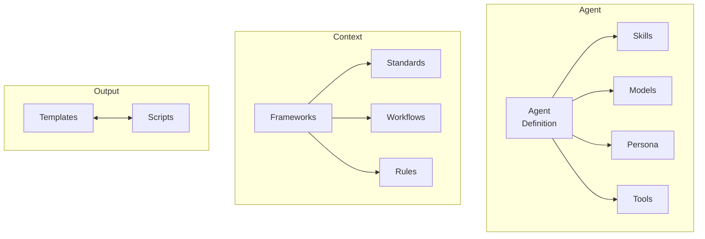
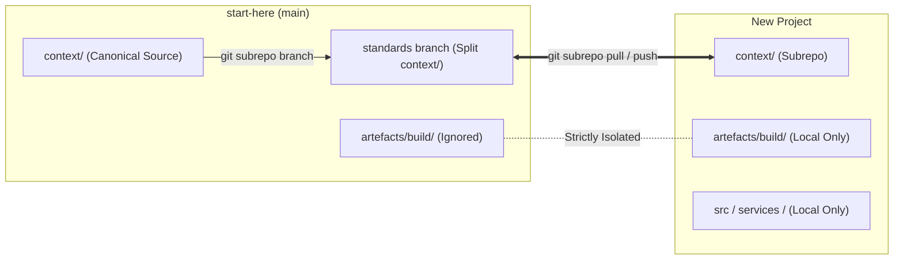

# Context Directory

## Table of Contents

Hydration index. Read only the section a task needs. This is the single navigational README for the whole `context/` tree — sub-directories are not individually documented.

1. [For Agents](#for-agents) — where everything lives, and how to change it safely
   - [Quick Reference](#quick-reference) — which directory holds what, and when to consult it
   - [Inventory](#inventory) — direct links to every rule, standard, skill, agent, workflow, template, persona, framework doc, script, and model profile
      - [Agent Inventory](#agent-inventory) — the role roster with model tiers
      - [Standards Map](#standards-map) — the Read when / Not for selection table
      - [Template Index](#template-index) — artefact output formats and naming
   - [File Type Overview](#file-type-overview) — purpose of each file type, with its add/edit/delete checklist
     - [Agent Definition Files](#agent-definition-files) — agents, personas, model profiles, skills
     - [Context Definition Files](#context-definition-files) — rules, standards, workflows, framework docs
     - [Output Definition Files](#output-definition-files) — templates, scripts
   - [Making Changes](#making-changes) — edit canonical files only, recompile projections, verify zero drift
     - [Adding New Rules](#adding-new-rules) — the three-question test before creating a rule
     - [Adding New Agents](#adding-new-agents) — template, frontmatter, and the mandatory recompile
2. [For Humans](#for-humans) — why the harness is shaped this way
   - [Harness Design](#harness-design) — the iron triangle, and the criterion-to-design-choice table
   - [Context Hierarchy](#context-hierarchy) — the invariant layers, and why rules and standards duplicate
3. [Downstream Synchronisation](#downstream-synchronisation) — distributing `context/` as a `git-subrepo`
   - [1. Prerequisites](#1-prerequisites) — required tooling
   - [2. Initial Project Setup](#2-initial-project-setup) — `subrepo clone`, pre-commit hook, projection compile
   - [3. Ongoing Synchronisation Workflows](#3-ongoing-synchronisation-workflows) — [pulling upstream](#pulling-upstream-updates) and [pushing improvements back](#pushing-improvements-back-upstream)
   - [4. Testing Downstream Standards](#4-testing-downstream-standards) — running the bundled test suite on a clone
   - [5. Upstream Maintenance & Automated Distribution (`agents-framework`)](#5-upstream-maintenance--automated-distribution-agents-framework) — CI checks: [freshness](#1-shift-left-freshness-checks-githubworkflowspr-subrepo-checksyml) · [reconciliation](#2-automated-reconciliation--push-githubworkflowspr-subrepo-pushyml) · [conflicts](#3-conflict-resolution--manual-fallback)
4. [Runtime Telemetry & Session Token Tracking](#runtime-telemetry--session-token-tracking) — how the `Agent-Session:` trailer is populated at commit time
   - [Multi-Runtime Comparison Matrix](#multi-runtime-comparison-matrix) — telemetry paths and token field names per runtime
   - [Architectural Principles](#architectural-principles) — container versus model, incremental extraction, error surfacing

---

## For Agents

### Quick Reference

| What                       | Where                  | When                                                 |
| -------------------------- | ---------------------- | ---------------------------------------------------- |
| **Framework docs**         | `docs/*.md`            | Reference manuals that describes this framework.     |
| **Non-negotiable rules**   | `rules/*.md`           | Invariant boundaries; verified by scripts/linters    |
| **Reference docs**         | `standards/*.md`       | Standards and benchmarks used by review rubrics      |
| **Agent definitions**      | `agents/*.md`          | Orchestrator spawns with Task tool                   |
| **Workflows**              | `workflows/*.yaml`     | Defines phase dependencies and agent assignments     |
| **Model profiles (LUT)**   | `models.yaml`          | Maps abstract model parameters to provider specifics |
| **Procedural skills**      | `skills/*.md`          | JIT workflows; evaluated by LLM-as-a-judge rubrics   |
| **Output templates**       | `templates/`           | Handoff, review, artefact formats                    |
| **Writing personas**       | `persona/*.md`         | Voice/style for human-facing content (blogs, papers) |
| **Validators**             | `scripts/validators/`  | Pre-commit hooks, CI/CD, adapter drift               |
| **Generators**             | `scripts/generators/`  | Unified runtime adapter CLI                          |


### Inventory

**Rules**: [bash-env](rules/bash-environment.md) · [multi-agent](rules/multi-agent-collaboration.md) · [python-env](rules/python-environment.md) · [secrets](rules/secrets.md) · [tech-writing](rules/tech-writing.md) · [testing](rules/testing.md) · [ts-env](rules/typescript-environment.md) · [ui-dev](rules/ui-dev.md) · [ui-testing](rules/ui-testing.md) · [workspace](rules/workspace-conventions.md)

**Standards**: [coding](standards/coding-standards.md) · [testing](standards/testing-standards.md) · [tech](standards/tech-standards.md) · [build](standards/build-standards.md) · [doc](standards/doc-standards.md) · [workflow](standards/workflow-standards.md) · [security](standards/security-standards.md) · [agent](standards/agent-standards.md) · [visual](standards/visual-standards.md) · [context](standards/context-framework.md) · [12-factor](standards/12-factor-principles.md) · [LESS](standards/LESS-Engineering-Principles.md) · [mobile](standards/tech-mobile-standards.md)

**Skills**: [agent-sandbox](skills/agent-sandbox.md) · [agent-workflows](skills/agent-workflows.md) · [arch-fidelity](skills/architecture-fidelity.md) · [bootstrap-workflow](skills/bootstrap-workflow.md) · [code-review](skills/code-review.md) · [database-design](skills/database-design.md) · [gcp-deployment](skills/gcp-deployment.md) · [git-subrepo](skills/git-subrepo-operations.md) · [intent-fidelity](skills/intent-fidelity.md) · [mermaid](skills/mermaid-authoring.md) · [multi-agent](skills/multi-agent-workflows.md) · [python-scripting](skills/python-scripting.md) · [supabase](skills/supabase-operations.md) · [tdd](skills/tdd-workflow.md) · [tech-authoring](skills/technical-authoring.md) · [ts-dev](skills/typescript-development.md) · [typst-pipeline](skills/typst-pipeline.md) · [ui-dev](skills/ui-development.md) · [ui-testing](skills/ui-testing.md)

**Agents**: [orchestrator](agents/orchestrator.md) · [product-owner](agents/product-owner.md) · [solution-architect](agents/solution-architect.md) · [ui-designer](agents/ui-designer.md) · [python-coder](agents/python-coder.md) · [typescript-coder](agents/typescript-coder.md) · [functional-tester](agents/functional-tester.md) · [tech-lead](agents/tech-lead.md) · [code-reviewer](agents/code-reviewer.md) · [principles-reviewer](agents/principles-reviewer.md) · [security-tester](agents/security-tester.md) · [ui-tester](agents/ui-tester.md) · [devops](agents/devops.md) · [documentation](agents/documentation.md) · [harness-analyst](agents/harness-analyst.md)

**Workflows**: [build](workflows/build.yaml) · [design](workflows/design.yaml) · [prototype](workflows/prototype.yaml) · [deploy](workflows/deploy.yaml) · [bugfix](workflows/bugfix.yaml) · [full-test](workflows/full-test.yaml) · [content](workflows/content.yaml) · [continuous-improvement](workflows/continuous-improvement.yaml) · [retrospective](workflows/retrospective.yaml)

**Templates**: [agent](templates/agent-template.md) · [logging](templates/logging-template.md) · [task](templates/task-prompt-template.md) · [handoff](templates/handoff-template.md) · [review](templates/review-template.md) · [pr](templates/pr-description-template.md)

**Personas**: [author](persona/author.md) · [technical-writer](persona/technical-writer.md) · [opinionated-blogger](persona/opinionated-blogger.md) · [editor](persona/editor.md) · [expert-reviewer](persona/expert-reviewer.md)

**Framework Docs**: [reference](docs/agentic-framework-reference.md) · [framework](docs/agentic-framework.md) · [rhythm](docs/rhythm-of-delivery.md)

**Scripts**: [validators](scripts/validators/README.md) · [generators](scripts/generators/generate_adapters.py) · [commit-msg](scripts/prepare-commit-msg.py) · [tests](scripts/tests/README.md)

**Model Profiles**: [models](models.yaml)


### Agent Inventory

| Agent | Model | Purpose |
|-------|-------|---------|
| **orchestrator** | large | Coordinates workflow execution, delegates to specialised agents, manages quality gates |
| **product-owner** | large | Elicits and structures requirements and user stories |
| **solution-architect** | large | Designs system architecture, component boundaries, data flow, and the canonical OpenAPI contract |
| **ui-designer** | medium | Designs UI layouts, component specs, design systems, and visual assets |
| **python-coder** | medium | Writes production Python code |
| **typescript-coder** | medium | Builds frontend and backend TypeScript |
| **functional-tester** | medium | Writes and runs TDD tests for Python and TypeScript |
| **tech-lead** | medium | Reviews code for architecture compliance — THE GATE |
| **code-reviewer** | medium | PR-style review focusing on bugs, edge cases, and maintainability |
| **principles-reviewer** | large | Reviews designs and implementations against LESS Engineering Principles |
| **security-tester** | medium | Identifies vulnerabilities via threat modelling and code analysis |
| **ui-tester** | small | Tests UI behaviour using browser automation |
| **devops** | medium | Designs physical schemas and migrations; deploys and validates infrastructure |
| **documentation** | medium | Generates user-facing docs, API references, and guides |
| **harness-analyst** | large | Owns the agent-facing harness (definitions, rules, skills, templates, workflows, validators) and measures it — workflow-analysis and tokenomics-audit lenses |

*Model tiers (small, medium, large) map to concrete provider models via `models.yaml`.*

### Standards Map

The orchestrator's Standards Resolution matches tasks against this table (`Read when` / `Not for`); `not-for` beats pool membership.

| Standard | Purpose | Read when | Not for |
|----------|---------|-----------|---------|
| [tech-standards](standards/tech-standards.md) | Tool and platform choices | Tech choices, project setup | Testing methodology, code patterns |
| [testing-standards](standards/testing-standards.md) | Testing methodology and TDD | Writing tests, coverage | Tool installation |
| [coding-standards](standards/coding-standards.md) | Code patterns and structure | Writing code, reviewing PRs | Tool choices |
| [security-standards](standards/security-standards.md) | Security principles | Auth design, data handling | Implementation details |
| [build-standards](standards/build-standards.md) | CI/CD and deployment | Pipelines, deploying | Tech stack choices |
| [doc-standards](standards/doc-standards.md) | Documentation structure | Writing docs, artefacts | Code patterns |
| [workflow-standards](standards/workflow-standards.md) | Development process | Starting work, TDD flow | Tool choices |
| [agent-standards](standards/agent-standards.md) | Agent behaviour and tools | Agent setup, tool usage | Tech stack |
| [visual-standards](standards/visual-standards.md) | Visual design standards | UI design | Backend, API |
| [LESS-Engineering-Principles](standards/LESS-Engineering-Principles.md) | Design philosophy | Architecture decisions | Implementation detail |
| [12-factor-principles](standards/12-factor-principles.md) | SaaS application patterns | Designing services | Frontend, mobile |
| [tech-mobile-standards](standards/tech-mobile-standards.md) | Mobile tech stack (deferred) | Mobile development | Web, backend |

**DRY Principle**: each topic lives in **one** authoritative place. Standards cross-reference rather than duplicate. If the same guidance appears in two places, the standard listed in the "Purpose" column above is the authority.

**Frontmatter Convention**: all standards use YAML frontmatter with `purpose`, `audience`, `read-when`, `not-for`, `related`.

### Template Index

The orchestrator consults this index when constructing a task prompt, references the matching template explicitly, and agents use whichever template the prompt specifies — they never select templates independently.

| Template | Output type | Output location |
|----------|-------------|-----------------|
| `requirements-template.md` | EARS-format requirements | `artefacts/product/requirements.md` |
| `user-stories-template.md` | User stories | `artefacts/product/user-stories.md` |
| `tasks-doc-template.md` | Task tracking | `artefacts/build/tasks-{branch}.md` |
| `bugs-template.md` | Bug tracker | `artefacts/build/bugs.md` |
| `review-template.md` | Tech or code review | `artefacts/build/{tech,code}-review.md` |
| `test-dashboard-template.md` | Test results dashboard | `artefacts/test-results/dashboard.md` |
| `handoff-template.md` | Agent handoff state | `artefacts/build/HANDOFF.md` |
| `commit-message-template.md` | Git commit message | git commit |
| `pr-description-template.md` | Pull request description | GitHub PR body |
| `domain-rules-template.yaml` | Domain-specific rules and blockers | `services/{domain}/context/domain-rules.yaml` |
| `architecture-template.md` | System architecture reference | `artefacts/architecture/architecture.md` |
| `design-template.md` | Feature design document | `artefacts/design/design-{feature}.md` |
| `agent-template.md` | New agent definition | `context/agents/{name}.md` |
| `logging-template.md` | Session metrics and interruption log schemas (JSONL) | `artefacts/build/metrics/session-log.jsonl` · `artefacts/build/interruptions/{task-id}.jsonl` |
| `task-prompt-template.md` | Agent task prompt (orchestrator use only) | — |
| `settings-local-template.json` | Claude Code / local runtime permissions | `.claude/settings.local.json` |

**Format notes** — Local Settings: copy to `.claude/settings.local.json` to configure autonomous command permissions (Git, `uv`, `yarn`, test runners) conforming to `bash-environment.md` without triggering manual prompt friction. Handoffs: keep summary under 500 characters; reference shared artefacts rather than duplicating content. Reviews: issue format `**ID** \`file:line\` Problem. → Fix.`; severity critical / high / medium / low. Architecture: system-level reference, one per project, present tense ("what IS built") — inline HTML comments mark monolith vs microservice sections. Design: one per feature; update to "Current (as-built)" after implementation.

**Naming**: templates use a `-template.{ext}` suffix. Generated files drop the `-template` suffix (e.g. `review-template.md` → `tech-review.md`).

### File Type Overview

#### Agent Definition Files

**Agents** (`agents/*.md`):

- Specialised agent definitions (who does what)
- Specialised `orchestrator.md` defines orchestrator behaviour; this is the first agent to spawn so must read at session start
- Frontmatter lists: allowed `model`, allowed `tools`, should follow `standards`, must follow `rules`, available `skills`
- Body lists: what to do before starting work, what to do whilst doing work, where to create deliverables. Orchestrator agent will append specific tasks at invocation.
- **On Add / Edit / Delete**: Create from `templates/agent-template.md` with required frontmatter. Validate via `uv run python context/scripts/validators/agent_definitions.py`. Update any `workflows/*.yaml` referencing the agent. **Mandatory recompile**: run `uv run python context/scripts/generators/generate_adapters.py` to project to `AGENTS.md` and vendor-specific runtimes. Verify with `adapter_drift.py`.

**Personas** (`persona/*.md`):

- Writing voice/style for human-facing content (blogs, papers, marketing)
- NOT for technical handoffs (README, API docs, architecture)
- See `docs/agentic-framework-reference.md` (Writing Personas) for when and how to use them
- **On Add / Edit / Delete**: Create or edit persona file (`name`, `description`, `traits`). No adapter recompilation needed.

**Model Profiles** & Runtime Telemetry LUT (`models.yaml`):

- Decouples agent definitions from vendor-specific model identifiers
- Defines abstract intent tiers (`small`, `medium`, `large`) mapped to model families
- Delegates precise model resolution to runtime adapters / environment configurations
- Catalogues multi-platform telemetry locations (Git trailers, Claude JSONL & Managed Agents Dreams, Antigravity transcripts)
- **On Add / Edit / Delete**: Update provider model names or aliases. **Mandatory recompile**: run `uv run python context/scripts/generators/generate_adapters.py` to update model mappings in vendor-specific runtimes. Verify with `adapter_drift.py`.

**Skills** (`skills/*.md`):

- Technology-specific procedural instructions and operational safeguards (Python scripting, git-subrepo, etc.)
- Injected just-in-time into subagent prompts based on matched file scopes or workflow hints
- **On Add / Edit / Delete**: Create or edit file with frontmatter (`name`, `description`, `globs`). Ensure `---` precedes `##` headings (Typst rule). Bind to relevant `agents/*.md` under `skills:` or workflow phases. **Mandatory recompile**: run `uv run python context/scripts/generators/generate_adapters.py` to update the `## Skills` index in `AGENTS.md` and project runtime skills in `.agents/skills/<name>/SKILL.md`. Verify with `adapter_drift.py`.

#### Context Definition Files

**Rules** (`rules/*.md`):

- Invariant boundaries and constraints that **break** if not followed
- Self-contained, actionable, binary (followed or not)
- Pre-commit hooks enforce these locally before any commit is recorded
- **On Add / Edit / Delete**: Create or edit with frontmatter (`description`, `globs`, `alwaysApply`). When adding or deleting, update applicable `agents/*.md` under `rules:`, then recompile adapters (`uv run python context/scripts/generators/generate_adapters.py`) and verify with `adapter_drift.py`.

**Standards** (`standards/*.md`):

- **How** to do things well (context, rationale, architectural benchmarks)
- Comprehensive reference documentation used by human and LLM reviewers
- Agents read on-demand (too verbose to preload)
- Examples: Python patterns, TDD philosophy, architecture decisions

- **On Add / Edit / Delete**: Create or edit ensuring `---` precedes all `##` headings (Typst rule). Add to `context/README.md` Quick Reference and the [Standards Map](#standards-map), and reference in applicable `agents/*.md` under `standards:`. If agent frontmatter was modified, recompile adapters (`generate_adapters.py`) and verify drift.

**Workflows** (`workflows/*.yaml`):

- Phase definitions, dependencies, quality gates
- Each phase lists agents, outputs, validation, and skills
- Source of truth for phase ordering
- **On Add / Edit / Delete**: Create or edit phase DAG. All referenced agents must exist in `context/agents/`. **Mandatory recompile**: run `uv run python context/scripts/generators/generate_adapters.py` to refresh workflow tables in `AGENTS.md` and `CLAUDE.md`. Verify with `adapter_drift.py`.

**Framework docs** (`docs/*.md`):

- Architectural companion paper (`docs/agentic-framework.md`): core concepts, verification split, and invariants
- Reference manual (`docs/agentic-framework-reference.md`): phase-by-phase workflows, orchestration patterns, agent catalogue, telemetry
- Delivery cadence (`docs/rhythm-of-delivery.md`): iteration rhythm, shipping cadence, and delivery loops
- **On Add / Edit / Delete**: Update architectural documentation. Verify documentation freshness with `uv run python context/scripts/validators/framework_docs_staleness.py`.

#### Output Definition Files

**Templates** (`templates/`):

- Output formats for artefacts, handoffs, reviews, git, and agent definitions
- The orchestrator selects the appropriate template when constructing a task prompt; agents use whichever template the task prompt specifies
- See the [Template Index](#template-index) in this README for the full list
- **On Add / Edit / Delete**: Create or edit template files. Update the [Template Index](#template-index) in this README. No adapter recompilation needed.

**Scripts** (`scripts/`):

- `prepare-commit-msg.py` / `.sh`: Git hook — extracts and injects session token usage across Claude Code, Google Antigravity, GitHub Copilot, and Codex into the Agent-Session commit trailer
- Validators (`validators/`): Pre-commit hooks mapping to canonical rules in `context/rules/*.md` (workspace conventions, tech writing, UI development, Supabase, testing, TypeScript environment, UI testing, secrets) plus repository integrity utilities (adapter drift, Typst formatting, framework docs staleness)
- Generators (`generators/`): Auto-generate CLAUDE.md/AGENTS.md from agent definitions and workflows
- Tests (`tests/`): Test suite for validators, runtime adapters, and telemetry extractors
- **On Add / Edit / Delete**: For standalone scripts, declare dependencies via PEP 723 inline metadata (`# /// script`). Add accompanying tests in `context/scripts/tests/`. Run test suite: `uv run --with pytest pytest context/scripts/tests/ -v`. If generator logic was altered, run `generate_adapters.py` and `adapter_drift.py`.

### Making Changes

Do not make changes to vendor-specific runtimes e.g. agent/SKILL.md or CLAUDE.md. Instead, make changes only to the canonical context files, recompile projections and verify zero drift:

```bash
uv run python context/scripts/validators/adapter_drift.py
```

Check that this readme, and especially the inventory, is still valid.

If any of `model LUT`, `tools`, `standards`, `rules`, `skills` has been added or deleted, you should check the frontmatter for each agent to see if any changes should be made.

#### Adding New Rules

When something keeps failing because agents don't follow it:

1. **Is it binary?** Can you definitively say "followed" or "not followed"?
2. **Does it break things?** Not just style—actual failures?
3. **Is it actionable?** Can you give clear DO/DON'T commands?

If yes to all three, create a rule in `rules/*.md` (keep under 200 tokens).

#### Adding New Agents

When a task domain needs repeated specialised work:

1. Copy `templates/agent-template.md`
2. Set `name`, `description`, `model` in frontmatter
3. List applicable `rules` and `standards` in frontmatter
4. Keep the template's body structure — `## Context Acquisition` is required by the validator — then add your role-specific workflow
5. Add to workflow YAML if part of standard process
6. Regenerate adapter projections: `uv run python context/scripts/generators/generate_adapters.py`


---

## For Humans




### Harness Design

This harness maps onto my formulation of the new iron triangle:

- **Autonomy**: The harness should be **flexible** working equally well for multi-agent orchestrated workflows and single-agent vibing sessions. It should be **portable**, its function not contingent on proprietary features. It should be **self-improving**, because it won’t stay optimised because of how fast the domain is moving.

- **Intent**: The harness should preserve the chain of intent by being as deterministic, and so testable, as possible. We do this by architecting clear **separation of concerns**: reasoning vs process, asserted vs evaluated, execution runtime vs workflow.

- **Tokenomics**: Not every token is equal; choice of caching, reasoning, model, output style all impact cost. The harness should be **token-efficient**: make the right trade-off between quality and cost.


| Criterion | Design choices |
| --------- | -------------- |
| **Flexible** | Agents are focused in purpose (specialist not generalist). |
|  | There is an agent primitive for an orchestrator agent. |
|  | The work is organised into workflows. Each workflow is not opinionated as to agent type or other workflows. |
| **Portable** | Harness is Git-native: a folder that can be copied into each new repo, written in Markdown or YAML. |
|  | Generator scripts express the harness onto a selected LLM runtime. |
| **Self-improving** | There are continuous-improvement workflows and agents. |
|  | Changes should be possible without wholesale rewrites of either context files or repos. |
|  | Versioning should be supported. |
| **Separation of concerns** | Context hierarchy; not all context needs to be ingested for every task. |
|  | Context scoped only to repo (as proxy for project). |
|  | Reject proprietary context. |
|  | Abstract runtime specifics from definitions. |
| **Token-efficient** | Agent definition includes choice of model. |
|  | Prefer tests over evaluation by agents. |
|  | Not all of every file needs to be ingested by agents: frontmatter to direct agents to applicable content within the file, terse text for agents, verbose text for humans at the bottom. |
|  | Files are to be consumed just in time. |

### Context Hierarchy

Each context window with an LLM, and each turn within each window, comprises context and thinking tokens.

A task is context that is actioned. The task is initiated in the prompt, either directly from the user or from the Orchestrator. Task context is by convention in a `artefacts/build/tasks-<git-branch>.md` file. Project context is in subfolders within `artefacts/`. These vary from task-to-task, project-to-project. In contrast, this hierarchy is invariant between projects.

**Specialised agents** do the work. An Orchestrator is a special type of agent that defines and allocates work for other sub-agents. The Documentation agent also uses **Persona** in order to write in the correct tone of voice. Agents are expressed upon an LLM runtime. The mapping of parameters in the agent definition file to a vendor's runtime is in a **Model Profiles Lookup Table** (LUT). Sometimes agents have not been well-trained on specific technologies and are prone to hallucinations. **Skills** give specific instruction in these cases.

**Global contxt** is pulled into each repo on demand as a subrepo. **Rules** break code if not adhered to. They can be written as assertions and so evaluated (in tests, pre-commit hooks, linters, AST parsers). **Standards** give context and rationale to how to do the work. Sections of standards should be loaded into context windwo on demand. They should be used as eval rubrics using a LLM-as-judge pattern. Orchestrators delegate to sub-agents according to the **workflow** they are following. More usefule for humans than agent, the **framework** gives the rationale for the harness and delivery philosophy.

The **output** is defined for consistency, to enable deterministic testing. By forcing agents to deliver work according to **templates** we assure that expected information is delivered. This context hierarchy is expressed as code (markdown, yaml). **Scripts** automate some tasks: projecting onto vendor-specific LLM runtime, testing.

Some duplication is intentional:

- Rules tell agents **what to do** (concise, actionable)
- Standards explain **why and how** (detailed, contextual)

An agent following a rule should succeed without reading standards. Standards exist for when someone asks "why?" or hits an edge case.

---

## Downstream Synchronisation

This context hierachy is distributed as a `git-subrepo`. The source repo is: `agents-framework` (`main` branch).

The framework distributes canonical context as a self-contained directory (`context/`). Downstream repositories import standards, workflows, and agents without inheriting project-specific tracking state (`artefacts/build/`, `artefacts/product/`, or application code).

Bi-directional synchronisation is managed via `git-subrepo` targeting an upstream `standards` distribution branch:




### 1. Prerequisites

Downstream workstations and CI runners require:

1. **Git** (version 2.30+)
2. **`git-subrepo`**:

   ```bash
   brew install git-subrepo
   ```

   *Note: Ensure Bash 4+ is available in your PATH (`brew install bash`).*
3. **`uv`**:

   ```bash
   curl -LsSf https://astral.sh/uv/install.sh | sh
   ```

### 2. Initial Project Setup

To adopt the framework in a new or existing repository:

#### Step 1: Import Canonical Context

Run `git subrepo clone` targeting the upstream `standards` branch:

```bash
git subrepo clone https://github.com/Schmoiger/agents-framework.git context -b main
```

This creates a local `context/` directory with its own `.gitrepo` tracking file. To developers on your team, `context/` appears as regular files in git—no detached `HEAD` states or recursive submodule commands are needed.

#### Step 2: Configure Pre-Commit Hooks

Add the adapter drift validator to your downstream `.pre-commit-config.yaml`:

```yaml
repos:
  - repo: local
    hooks:
      - id: adapter-drift
        name: Validate Runtime Adapter Drift
        entry: uv run python context/scripts/validators/adapter_drift.py
        language: system
        files: ^(context/|AGENTS\.md|GEMINI\.md|CLAUDE\.md|\.agents/|\.claude/|\.github/|\.openai/)
```

Install the pre-commit hook:

```bash
uv run pre-commit install
```

#### Step 3: Compile Runtime Projections

Run the adapter generator to produce runtime projections (`AGENTS.md`, `GEMINI.md`, `CLAUDE.md`, etc.):

```bash
uv run python context/scripts/generators/generate_adapters.py
```

Commit the generated projections:

```bash
git add .
git commit -m "chore(infra): import standards via git-subrepo and compile projections"
```

### 3. Ongoing Synchronisation Workflows

#### Pulling Upstream Updates

When standards, rules, or agent definitions are updated in `agents-framework`, pull changes into your downstream repository:

```bash
# 1. Pull upstream changes into context/
git subrepo pull context

# 2. Re-compile runtime adapter projections
uv run python context/scripts/generators/generate_adapters.py

# 3. Verify zero drift
uv run python context/scripts/validators/adapter_drift.py

# 4. Commit updated projections
git add -A
git commit -m "chore(standards): update canonical context and regenerate adapters"
```

#### Pushing Improvements Back Upstream

If your project enhances or fixes a standard, rule, or agent prompt inside `context/`, you can push the improvement back to the upstream `standards` branch:

```bash
# 1. Ensure tests and drift checks pass
uv run python context/scripts/validators/adapter_drift.py
uv run pytest context/scripts/tests -v

# 2. Push context/ changes directly upstream
git subrepo push context
```

Once pushed, changes are committed upstream to `agents-framework` `main`.

### 4. Testing Downstream Standards

All validator, adapter, and compilation tests are packaged inside `context/scripts/tests/` and accompany `context/` when cloned via subrepo. Downstream projects can run the test suite at any time:

```bash
uv run pytest context/scripts/tests -v
```

### 5. Upstream Maintenance & Automated Distribution (`agents-framework`)

The project automatically maintains synchronisation with upstream canonical subrepos using two coordinated GitHub Actions workflows:

#### 1. Shift-Left Freshness Checks (`.github/workflows/pr-subrepo-checks.yml`)

During pull request review, before merging into `main`:
- The workflow runs `context/scripts/validators/subrepo_freshness.py`.
- If changes were made to `context/**` or `typst/**`, it queries the canonical upstream remote (`Schmoiger/agents-framework` or `Schmoiger/typst-engine`).
- If upstream has newer commits that are not yet pulled, the check fails with an actionable warning, requiring the author to run `git subrepo pull <subdir>` on their feature branch prior to merging.

#### 2. Automated Reconciliation & Push (`.github/workflows/pr-subrepo-push.yml`)

Whenever pull requests touching `context/**` or `typst/**` are merged into `main`, the `pr-subrepo-push` workflow:

1. Checks out the repository with complete commit history (`fetch-depth: 0`).
2. Evaluates `UPSTREAM_PUSH_TOKEN` authentication secrets.
3. Installs `git-subrepo` (v0.4.9).
4. **Automated 3-Way Reconciliation**: Fetches the upstream tracking ref. If upstream has advanced ahead of local `.gitrepo`, it automatically performs `git subrepo pull <subdir>` to merge changes cleanly before pushing.
5. Pushes reconciled changes upstream to canonical repositories (`Schmoiger/agents-framework` and `Schmoiger/typst-engine`).
6. Pushes updated subrepo `.gitrepo` tracking commits back to `main`.
7. Generates a structured status report in `$GITHUB_STEP_SUMMARY`.

#### 3. Conflict Resolution & Manual Fallback

If upstream and local changes conflict semantically and cannot be auto-merged:
1. The CI workflow flags the conflict in `$GITHUB_STEP_SUMMARY` without corrupting working tree state.
2. Maintainers resolve the conflict locally:

```bash
# 1. Ensure local main is up to date
git checkout main && git pull

# 2. Pull upstream into the subrepo and resolve conflicts
PATH="/opt/homebrew/bin:/usr/local/bin:$PATH" git subrepo pull context

# 3. Verify tests and commit resolved files
git add context/
git commit -m "fix(subrepo): resolve upstream merge conflicts"

# 4. Push cleanly back upstream
PATH="/opt/homebrew/bin:/usr/local/bin:$PATH" git subrepo push context

# 5. Push updated tracking state back to main
git push origin main
```

---

## Runtime Telemetry & Session Token Tracking

The framework tracks cumulative token consumption directly from the underlying AI development runtimes and injects incremental deltas into the `Agent-Session:` git trailer at commit time via `.git/hooks/prepare-commit-msg` (delegating to `context/scripts/prepare-commit-msg.py`).

### Multi-Runtime Comparison Matrix

| Runtime | Local Telemetry Path | Repo Mapping Mechanism | Storage Format | Extracted Token Fields |
|---|---|---|---|---|
| **Anthropic Claude Code** | `~/.claude/projects/{mangled}/` | Path hash: `repo.replace('/', '-')` | JSONL (`{session}.jsonl` & `subagents/*.jsonl`) | `message.usage.input_tokens` (+ cache creation/read) & `output_tokens` |
| **Google Antigravity** | `~/.gemini/antigravity-ide/conversations/*.db` | SQLite `trajectory_metadata_blob` (`file://{repo}`) | SQLite + Protobuf binary in `gen_metadata` | Protobuf Field 1.4: Varint 2 (prompt), Varint 5 (cached), Varint 3 (output), Varint 9/10 (thinking/candidates) |
| **GitHub Copilot Chat** | `Code/User/workspaceStorage/<id>/chatSessions/` | `workspace.json` (`"folder": "file://{repo}"`) | JSONL (`<session-id>.jsonl`) | `metadata.promptTokens`, `metadata.outputTokens` / `completionTokens`, `toolCallRounds[].thinking.tokens` |
| **OpenAI Codex** | `~/.codex/` or API run logs | Project directory or API run trace | JSON / SQLite | `prompt_tokens`, `completion_tokens`, `reasoning_tokens` |

### Architectural Principles

1. **Separation of Runtime Container vs Model**:
   - The `tool=` field in `Agent-Session:` dictates the **execution container** (e.g. `tool=antigravity`, `tool=copilot`, `tool=claude-code`).
   - The `model=` field specifies the LLM (e.g. `model=gemini-flash`, `model=sonnet`, `model=gpt-5-mini`).
   - For example, running Claude Sonnet inside Google Antigravity produces `tool=antigravity model=sonnet`, causing the hook to query Antigravity's local session DB rather than Claude Code CLI storage.
2. **$O(\Delta)$ Incremental Token & Compute Efficiency**:
   - Never re-parse entire conversational histories on each commit.
   - **Antigravity**: Watermark stores `last_idx` and queries SQLite incrementally:
     `SELECT idx, data FROM gen_metadata WHERE idx > ? ORDER BY idx ASC`
   - **Copilot & Claude**: Watermark stores the file byte offset and `seek()`s directly to newly appended lines.
3. **Transparent Error Surfacing over Silent Failure**:
   - If an agent commit trailer (`Agent-Session:`) is present but telemetry extraction fails (e.g., unexpected schema change or missing session), the hook injects:

     ```text
     Agent-Session: tool=antigravity model=gemini-flash ... tokens=error(schema_drift)
     ```

   - Diagnostic warnings are written to `stderr`, and the commit is allowed to succeed with exit code 0.
4. **Brittleness & Maintenance**:
   - Neither Antigravity nor Copilot provides a public, frozen API for local telemetry; extraction relies on internal storage patterns.
   - The test suite in `context/scripts/tests/test_runtime_telemetry.py` includes live runtime sanity checks that run in local development:
     - **Not installed**: Skipped cleanly.
     - **Installed but idle**: Skipped with diagnostic note (`"Runtime installed but no active sessions found for validation"`).
     - **Installed with active sessions**: Fails immediately if vendor schema changes or data formats drift.
