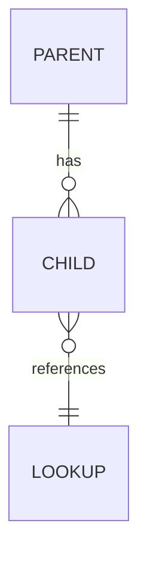

# Database Design Skill

**Applies to**: any task that defines or changes a physical schema, its constraints, or its indexes.

---

## Conceptual vs Physical

The `@solution-architect` owns `{project-root}/artefacts/architecture/data-model.md` as a **conceptual** model: entities, relationships, and business rules in prose. You own the **physical** implementation.

- Translate conceptual entities into tables, columns, types, and constraints
- Add implementation detail the conceptual model does not carry: indexes, triggers, defaults, check constraints
- Make performance decisions explicitly: denormalisation, partitioning, materialised views
- Record every deviation from the conceptual model in `{project-root}/artefacts/database/design-decisions.md` — with the technical reason

**Never modify `data-model.md`.** If the conceptual model appears wrong, report the finding to the architect rather than editing their source of truth.

---

## Physical Design Rules

1. **PostgreSQL by default** — state explicitly when another engine is in use, and translate the rules below to its idioms.
2. **Normalise first** — reach for denormalisation only when a measured performance requirement justifies it, and record the trade-off.
3. **UUID primary keys** — `uuid` with `gen_random_uuid()` unless a stated reason (legacy import, natural key stability) says otherwise.
4. **snake_case naming** — tables plural, columns singular; no quoted mixed-case identifiers.
5. **Timestamps** — every table carries `created_at` and `updated_at`, both `timestamptz NOT NULL DEFAULT now()`; maintain `updated_at` in a trigger, not in application code.
6. **Index foreign keys and common queries** — an unindexed FK is a latent sequential scan; add composite indexes in the order the query filters.
7. **Constraints belong in the database** — `NOT NULL`, `CHECK`, `UNIQUE`, and FK constraints enforce invariants that application code can bypass.
8. **Destructive changes need a plan** — renaming or dropping a column requires a backfill and a compatibility window, documented before it ships.

---

## ER Diagram

Render the physical model as a Mermaid `erDiagram` in `{project-root}/artefacts/database/er-diagram.md`, following `mermaid-authoring.md`:




Show the tables, keys, and relationship cardinality that a reader needs to understand the model — not every column.

---

## Validation

Migrations are validated by a **schema assertion**, not by a dry run: query `information_schema.columns` or `pg_indexes` through `mcp__supabase__execute_sql` and assert the expected shape. Every migration also inserts its audit row into `schema_migrations` (`supabase-operations.md` §1).

Validate markdown outputs with:

```bash
uv run python context/scripts/validators/verify_typst_formatting.py {files}
```

---

## Why

A physical schema outlives the code that first wrote it: every consumer, every migration, and every query plan depends on decisions made here. Documenting deviations and enforcing invariants in the database keeps the model honest as the system grows; an undocumented divergence between conceptual and physical schemas silently corrupts both.
