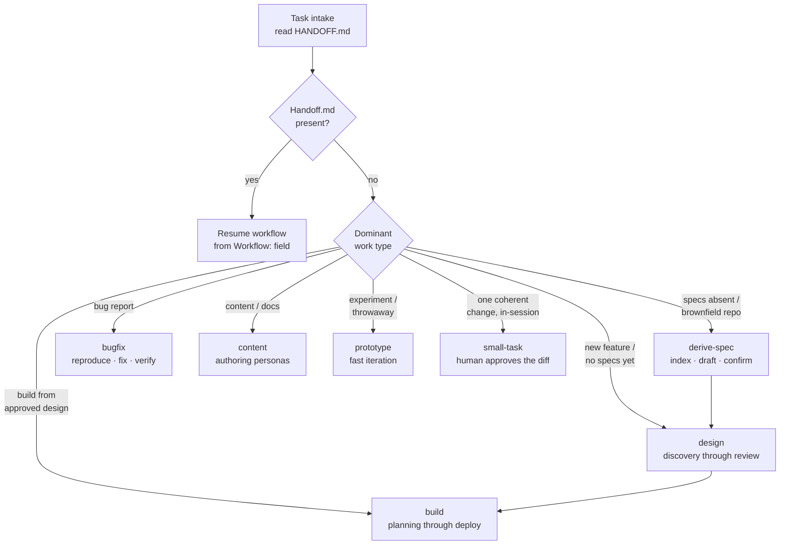
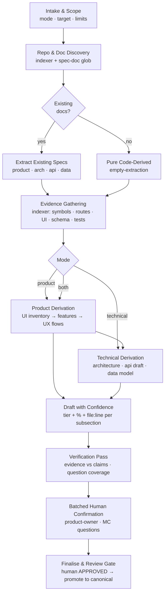
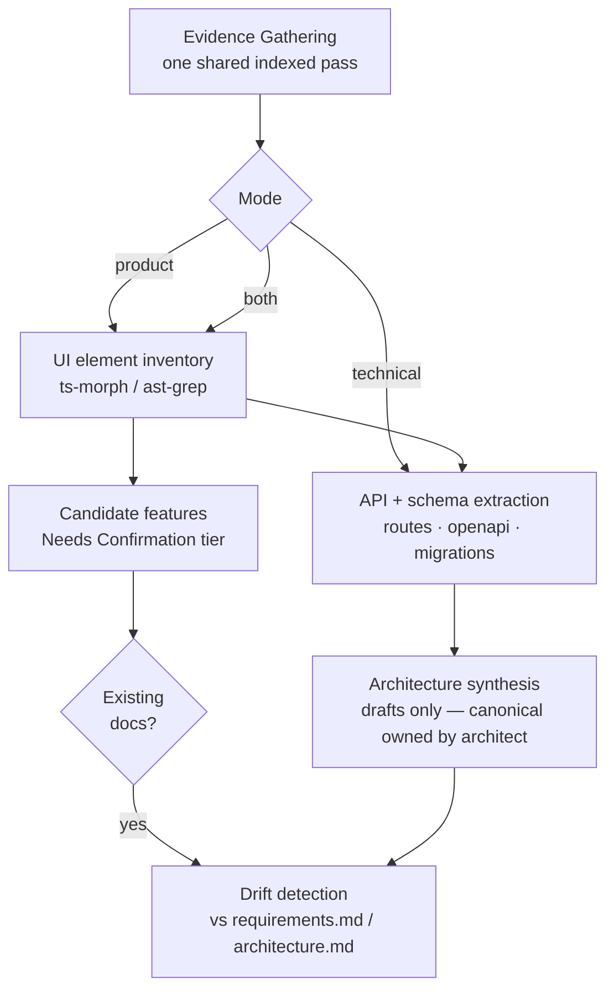

# Workflows

Navigational index for the workflow definitions in `context/workflows/*.yaml`.

Each workflow YAML is the durable specification (phases, agent assignments,
validation criteria, quality gates, state recovery). This README is the overlay:
**when to pick a workflow**, and **how the derive-spec workflow runs its tools**.

---

## 1. Workflow Table

| Workflow | File | Purpose | Human gate |
|----------|------|----------|-------------|
| `build` | `build.yaml` | Subtask planning through local deployment — the primary development loop | Approval at task-planning, tasks-review, coverage, quality, final review |
| `bugfix` | `bugfix.yaml` | Empirical bug reproduction, fix, and verification — a commit is the record | Approval at reproduce and fix gates |
| `content` | `content.yaml` | Human-facing content creation with writing personas | Review per artefact |
| `continuous-improvement` | `continuous-improvement.yaml` | Framework improvement — reactive or proactive | Per retrospective |
| `deploy` | `deploy.yaml` | GCP cloud deployment and deployment review, after build local-deployment | Approval before production deploy |
| `design` | `design.yaml` | Discovery through design review — run before build | Approval at design-review gate |
| `derive-spec` | `derive-spec.yaml` *(planned)* | Derive product and technical specifications from an existing codebase (brownfield, organised or not), via deterministic indexing + agent synthesis | Approval at final review before promotion |
| `full-test` | `full-test.yaml` | Full-suite testing across all modules — run before merge to main or on demand | Gate verdict per suite |
| `prototype` | `prototype.yaml` | Fast iteration workflow for prototyping and experimentation | Human checkpoint per iteration |
| `small-task` | `small-task.yaml` | Small, single-change, human-approved tasks done directly by the default agent | The approval is the gate (always) |

---

## 2. Selecting a Workflow




Deciding principle (see `context/agents/orchestrator.md` § Intake and
`small-task.yaml` § fitness): over-formalism is cheap, under-formalism is
expensive. When unsure, default to the heavier workflow.

---

## 3. derive-spec (planned)

### 3.1 Overview




### 3.2 Mode Branch




### 3.3 Design Decisions

| Dimension | Decision | Rationale |
|-----------|----------|-----------|
| Modes | `product` / `technical` / `both`, set at intake | Shared phases run once; product/technical phases branch after evidence gathering |
| Discovery | Glob-based candidates, confirmed by a human | Structured and unstructured repos; no silent guessing |
| Confidence | Tier (Verified / Needs Confirmation / Assumed) + % + `file:line` citation | Auditable and elicitable; citations originate from the indexer |
| Human interaction | One batched multiple-choice round, citing files | Highest-value interruption profile; supports a "skip questions" escape |
| Output lifecycle | Derived drafts first; promotion only behind approval | Never clobbers canonical `artefacts/` docs; architect owns `openapi.yaml` |
| Scope limits | `max-files` flag surfaces large repos | The analysis agent reads an index, so size is bounded |

---

## 4. Runtime — how the workflow uses tools

The deliberate design: **everything mechanically derivable from source is
extracted deterministically (~0 LLM tokens); the agent consumes the compact
index and spends its budget on synthesis, judgement, and writing.**

| Phase | Determined by | Zero-LLM tools | Agent (LLM) focus |
|-------|---------------|----------------|-------------------|
| 1. Discovery + scan | Indexer subprocess | `git ls-files`, language detection, doc globs | Confirms the discovered doc list |
| 2. Existing-spec extraction | Indexer | doc classification | Reads the prose docs (small) |
| 3. Evidence gathering | Indexer | stdlib `ast` (Python), TS/JSX heuristics, SQL `CREATE TABLE` parser, PyYAML OpenAPI, `pytest --collect-only`, `yarn test --listTests` | Cross-index reasoning over `repo-index.json`; targeted line-range reads only |
| 4a. Product derivation | Agent + indexer | component/prop inventory (UI) | Features from UI inventory; UX flows via call chains |
| 4b. Technical derivation | Agent + indexer | route/schema/API inventory | Architecture, API draft, data-model draft |
| 5. Draft + confidence | Agent | — | Subsections: tier + % + citations; open questions |
| 6. Verification | `verify` subcommand | citation resolution re-check | Fixes unresolved or uncovered claims |
| 7. Human confirmation | Human + product-owner | — | Batched MC questions (reverse-spec format) |
| 8. Finalise + review gate | Orchestrator + human | `verify --doc` on the final drafts | Human APPROVED, then promotion + commit |

### 4.1 Commands

```bash
# Phase 1/3 — build the index and the compact evidence map (zero LLM tokens)
uv run context/scripts/spec_indexer.py scan --repo . --mode both
# → artefacts/build/repo-index.json  (structured index)
# → artefacts/build/spec-scan.md      (human/agent-readable evidence map)

# Phase 6 — every citation in the index resolves
uv run context/scripts/spec_indexer.py verify --index artefacts/build/repo-index.json

# Phase 8 — every file:line cited by a drafted spec doc resolves
uv run context/scripts/spec_indexer.py verify --doc artefacts/product/product-spec.derived.md
```

### 4.2 Repository Index (`repo-index.json`)

Produced by `scan`; consumed by every derive-spec agent.

| Key | Contents |
|-----|----------|
| `meta` | repo, absolute root (`repo_abs`), UTC `generated_at`, mode, file/language counts, LOC, `scan_too_large` flag |
| `warnings` | scan-level warnings (e.g. size threshold, collection method) |
| `docs` | existing spec documents: `[ {path, kind} ]` — `requirements │ architecture │ api │ design │ docs │ discovery │ prd │ tsd │ spec │ readme │ openapi` |
| `files` | per file: path, language, line count, `symbols` (kind, name, signature, line, decorators, props), imports |
| `api` | `[ {method, path, handler(=function or operationId), file, line} ]` from route decorators (FastAPI/Flask) and OpenAPI documents |
| `schema` | `[ {table, columns:[{name,type}], file, line} ]` from SQL migrations plus OpenAPI schema names |
| `ui` | `[ {component, file, line, props, usages, kind} ]` from TS/JSX component definitions, aggregated with JSX-tag usage counts |
| `tests` | `[ {node_id, file} ]` from pytest collection / jest listTests — each test name is a candidate feature |

The index is deterministic: re-running the scan on the same tree is idempotent,
and `verify` will fail any citation that no longer resolves after edits.

---

## 5. Token Ledger (derive-spec pilots)

Measured during the T-008 pilot on this repo (`mode=both` skeleton figures;
before/after comparison is the acceptance metric):

| Work | Zero-LLM tools | Agent LLM (rough) |
|------|----------------|-------------------|
| Scan + inventory (198 pytest node-ids in 0.09s, `ast`, route/schema/UI extractors) | ~0 tokens | ~0 |
| Synthesis: features, UX flows, architecture, API, data model | — | ~25–60k |
| Elicitation (batched MC) + finalise | — | ~10–25k |
| **Naive alternative** (agent reads the repository itself) | — | ~200–500k, bounded by repo size |

`@harness-analyst` may audit this with the `tokenomics-audit` lens (glob
`artefacts/build/**`).

---

*See also: `context/README.md` for the full context inventory; each workflow's
phase `validation:` blocks are normative.*
