# Workflows

Navigational index for the workflow definitions in `context/workflows/*.yaml`.

Each workflow YAML is the durable specification — phases, agent assignments,
validation criteria, quality gates, state recovery. This README overlays it with
three things: **when to pick a workflow** (§2), **what each workflow contains**
(§4, diagrams + agent notes), and **how the derive-spec workflow runs its tools**
(§3.2, §5).

---

## Workflow Table

| Workflow | File | Purpose | Human gate |
|----------|------|----------|-------------|
| `build` | `build.yaml` | Subtask planning through local deployment — the primary development loop | task-planning, tasks-review, coverage, quality, final holistic review |
| `bugfix` | `bugfix.yaml` | Empirical bug reproduction, fix, and verification — a commit is the record | reproduce and verify gates |
| `content` | `content.yaml` | Human-facing content creation with writing personas | Editorial review per artefact |
| `continuous-improvement` | `continuous-improvement.yaml` | Framework improvement — reactive (incident) or proactive (retrospective) | Retrospective discuss gate |
| `deploy` | `deploy.yaml` | GCP cloud deployment and deployment review, after build local-deployment | deployment-review gate |
| `design` | `design.yaml` | Discovery through design review — run before build | design-review gate |
| `derive-spec` | `derive-spec.yaml` *(planned)* | Derive product and technical specifications from a codebase (organised or not) via deterministic indexing + agent synthesis | final review before promotion |
| `full-test` | `full-test.yaml` | Full-suite testing across all modules — run before merge to main or on demand | quality-check gate |
| `prototype` | `prototype.yaml` | Fast iteration workflow for prototyping and experimentation | None (skip on promotion) |
| `small-task` | `small-task.yaml` | Small, single-change, human-approved tasks done directly by the default agent | The approval is the gate (always) |

---

## Selecting a Workflow

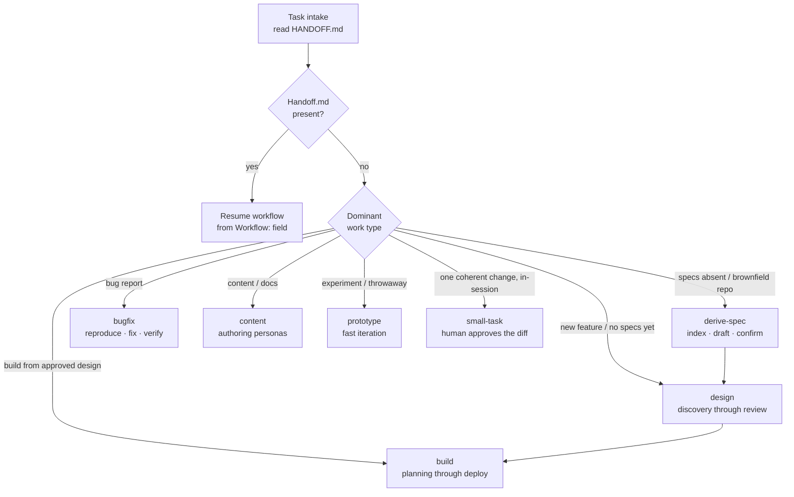

Deciding principle (see `context/agents/orchestrator.md` § Intake and
`small-task.yaml` § fitness): over-formalism is cheap, under-formalism is
expensive. When unsure, default to the heavier workflow.

---

## bugfix.yaml

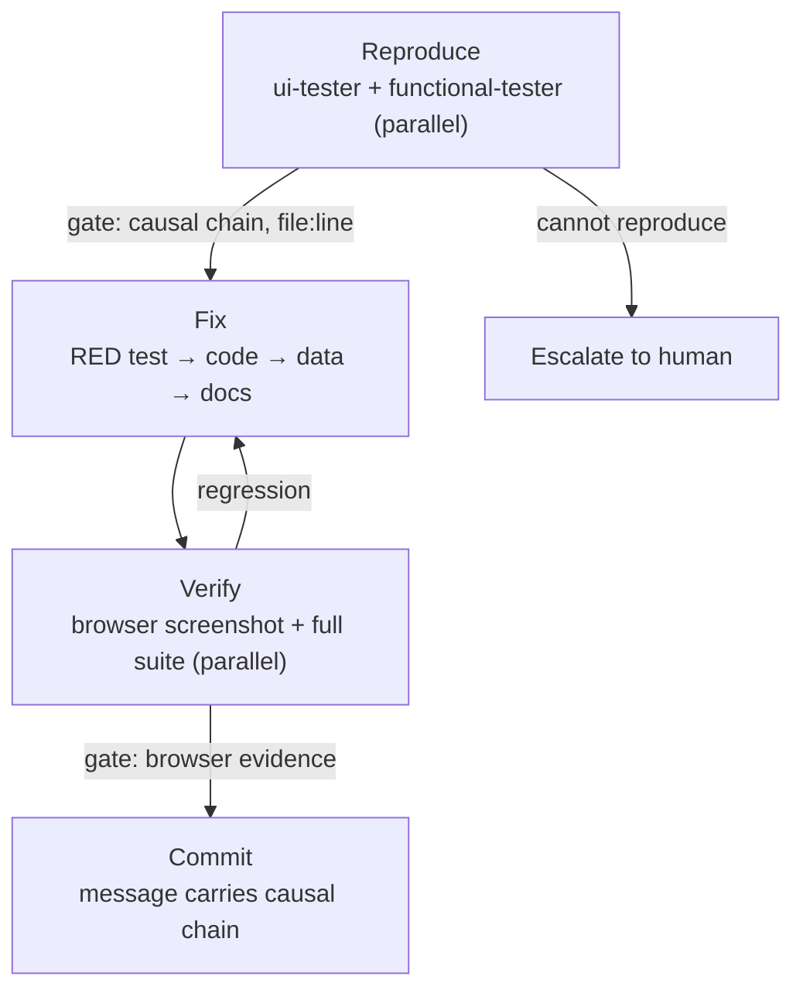

### Notes for agents

- **Reproduce-gate discipline**: root cause must be a code-cited causal chain   (symptom → handler → function → data source → root cause) written into `artefacts/bugfix/reproduce-evidence.md`. Names are not evidence — column,   file, function, or module names describe intent, not implementation. The gate blocks when any step lacks a `file:line` citation from Read/Grep.
- Spawn order in `fix`: `@functional-tester` writes the failing test **first** (TDD Red, commit it before any code change — git is the compaction recovery point), then only the relevant coder(s) (`@python-coder` / `@typescript-coder`). Do not modify the test to make it pass.
- `verify` requires **browser evidence** (screenshot `after/` + console state) — a green test suite alone does not satisfy the gate. Full regression run by `@functional-tester` must show no new failures.
- Data fixes (Supabase MCP or migration) and doc fixes are part of the same fix, never deferred. Screenshots before/after go in `artefacts/bugfix/screenshots/{before,after}/`.
- The commit message is the record: what the bug was, the causal-chain summary, what changed (code/test/data/docs) and why.
- For the parallel reproduce phase, write `artefacts/bugfix/dispatch.md` before spawning, recording each agent's task and expected output.

---

## build.yaml

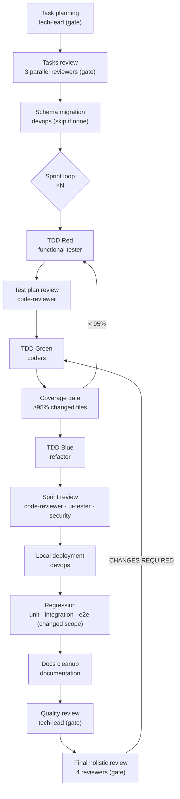

### Notes for agents

- **task-planning**: `@tech-lead` decomposes into `artefacts/build/subtask-plan.yaml`. Every subtask carries a command-verifiable AC, a minimal context bundle (line-range references where possible), a `file_scope` disjoint from parallel subtasks, and `max_retries` (default 2). Streams: python / typescript. 
- **Spark rules**: tdd-red writes failing tests only (bash allowed for `pytest --collect-only` / `yarn test --listTests`); tdd-green implements; tdd-blue refactors with Write removed — no new files during refactor. 
- **Loop detection**: two consecutive identical failures → level-1 (orchestrator augments the context bundle, one re-spawn) → level-2 (suspend sprint, escalate to the human). Subtasks report COMPLETE/FAILED with exact command output; they never retry independently.
- **Quality gates** (in order): tasks-review → coverage-gate (automated, returns to tdd-red) → quality-review (tech-lead) → final-holistic-review (all four reviewers, parallel). Threshold 95% on changed/new files.
- **Regression** runs **once** after all sprints, scoped to changed modules/interfaces/workflows. Full-suite verification is `full-test.yaml`; cloud deployment is `deploy.yaml` after local-deployment.
- **docs-cleanup**: archive superseded artefacts, never delete; HANDOFF.md gets a final handoff entry; build/tasks.md status must be current.


---

## content.yaml

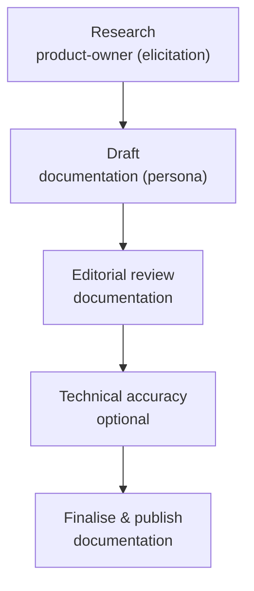

### Notes for agents

- Human-facing content only (blogs, papers, guides). Technical handoffs and API docs belong to `build.yaml` docs-cleanup, not here.
- A writing persona must be specified in the task: `technical-writer` for guides, `opinionated-blogger` for blog posts. Keep the persona voice consistent across phases.
- Draft validation: persona voice, British English, an opening hook, concrete examples. Editorial review rejects AI-slop patterns (em dashes, triads, vapid transitions). `technical-review` is optional — skip for non-technical content.
- Outputs move from `artefacts/content/drafts/` to `artefacts/content/published/`.


---

## continuous-improvement.yaml

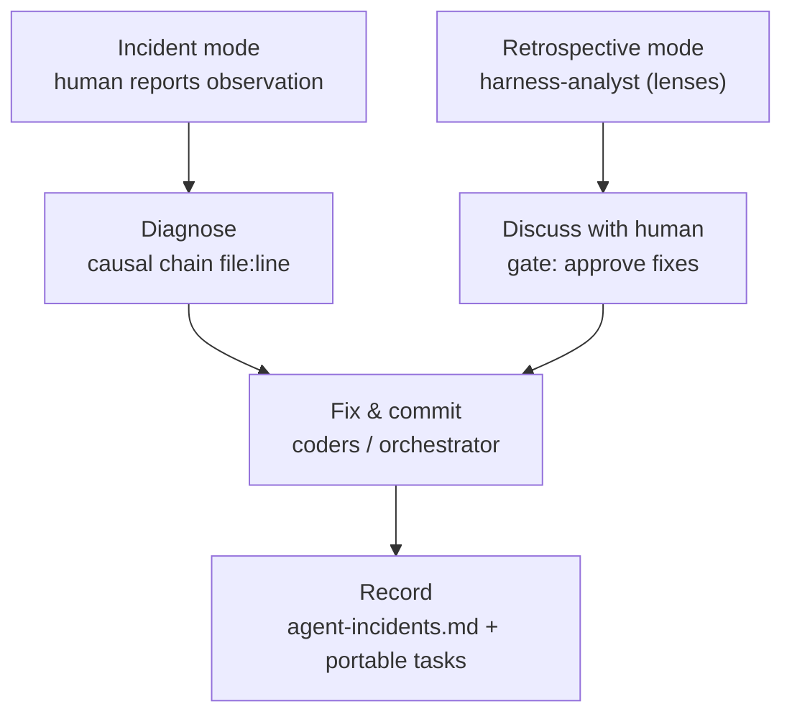

### Notes for agents

- Two modes: **incident** (human reports a failure — one incident per run, proceeds on diagnosis) and **retrospective** (after a deployment or sprint or on demand — multiple findings, but the human decides which to fix at the discuss gate).
- `@harness-analyst` modes: name the lens in the task prompt (`workflow-analysis` macro or `tokenomics-audit` micro). Spawn twice in parallel with disjoint outputs (efficiency-report.md vs tokenomics-report.md) if both lenses are needed.
- Retrospective data sources: `interruptions/*.jsonl`, `metrics/session-log.jsonl`, `agent-incidents.md`, and git log Agent-Session lines (`tokens=`, `duration=`, `agents=`, `dispatch=`, `interactions=`, `approvals=`). Aggregate per agent / sprint / task; compute autonomy rate.
- Every finding must lead to a **fixable gap** — no vanity metrics or health scores. Present findings as patterns with evidence, each framed pattern → root cause → proposed fix.
- In `fix`, standards/rules/templates may be edited directly by the orchestrator (under 50 lines per file); delegate larger changes to coders. `record` updates the incident entry (root cause, fix, commit hash) and appends portable fixes to `tasks-context-framework.md` with rationale, file list, and acceptance criteria.

---

## deploy.yaml

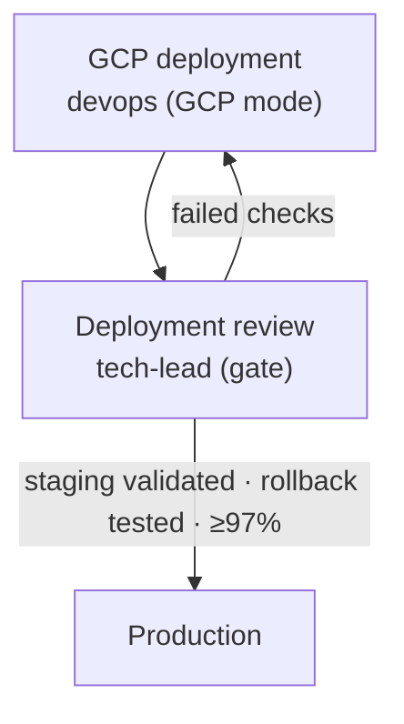

### Notes for agents

- `@devops` operates in GCP mode (Terraform + gcloud), not Supabase mode — orchestrator names the mode at spawn. Terraform validate + plan before apply; staging before production.
- The rollback plan is mandatory before the gate can APPROVE. Coverage threshold rises to **97%** here (higher than build's 95% quality-review threshold).
- Run after `build.yaml` local-deployment is complete; deployment-guide and security-checklist land in `artefacts/gcp/`.

---

## derive-spec.yaml

### Overview

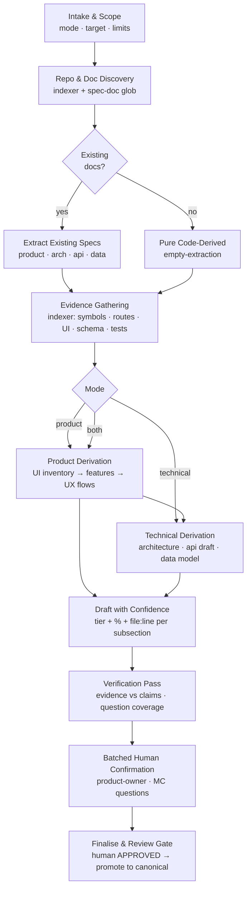

### Runtime Sequence

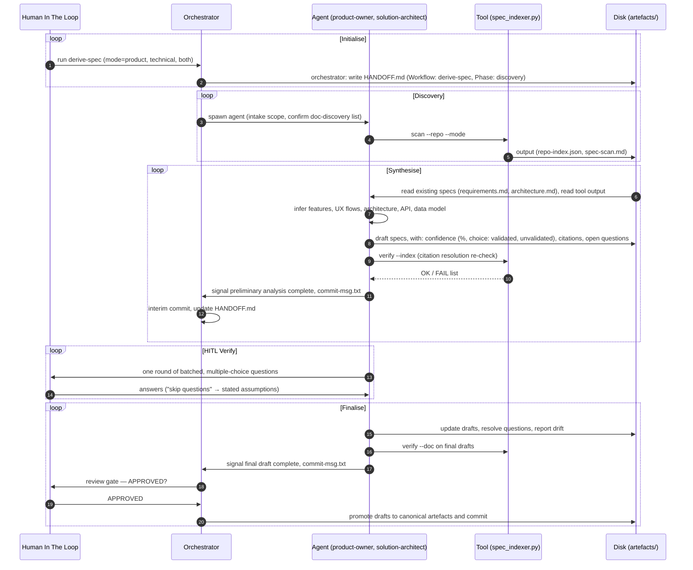

| Action | Tool (@ zero token cost) | Agent (@ token spend) |
|-------|----------------|-------------------|
| Discovery + scan | `git ls-files`, language detection, doc globs | Confirms the discovered doc list |
| Existing-spec extraction | doc classification | Reads the prose docs (small) |
| Evidence gathering | stdlib `ast` (Python), TS/JSX heuristics, SQL `CREATE TABLE` parser, PyYAML OpenAPI, `pytest --collect-only`, `yarn test --listTests` | Cross-index reasoning over `repo-index.json`; targeted line-range reads only |
| Product derivation | component/prop inventory (UI) | Features from UI inventory; UX flows via call chains |
| Technical derivation | route/schema/API inventory | Architecture, API draft, data-model draft |
| Draft + confidence | — | Subsections: tier + % + citations; open questions |
| Verification | citation resolution re-check using `verify` subcommand | Fixes unresolved or uncovered claims |
| Human confirmation | — | Batched MC questions (reverse-spec format) |
| Finalise + review gate | `verify --doc` on the final drafts | Human APPROVED, then promotion + commit |

### Notes for agents

- Be token-efficient: invoke tools analyse the repo using the analyse-repo skill rather than doing the work yourself
- 3 modes: `product` / `technical` / `both`; set at intake. Shared phases run once; product/technical phases branch after evidence gathering
- Do not assume a directory structure, find candidates by searching globs
- Batch the human interactions. Use requirements-elicitation skill to question the human. If the answers are not known, the confidence does not improve.
- Do not rewrite existing docs; analysis produces new docs only
- Respect scope limits to bound token burn; `max-files` flag surfaces large repos; read the index to target file reads

### Commands

```bash
# Phase 1/3 — build the index and the compact evidence map (zero LLM tokens)
uv run context/scripts/code-specs/spec_indexer.py scan --repo . --mode both
# → artefacts/build/repo-index.json  (structured index)
# → artefacts/build/spec-scan.md      (human/agent-readable evidence map)

# Phase 6 — every citation in the index resolves
uv run context/scripts/code-specs/spec_indexer.py verify --index artefacts/build/repo-index.json

# Phase 8 — every file:line cited by a drafted spec doc resolves
uv run context/scripts/code-specs/spec_indexer.py verify --doc artefacts/product/product-spec.derived.md
```

### Repository Index (`repo-index.json`)

Produced by `scan`; consumed by every derive-spec agent.

| Key | Contents |
|-----|----------|
| `meta` | repo, absolute root (`repo_abs`), UTC `generated_at`, mode, file/language counts, LOC, `scan_too_large` flag |
| `warnings` | scan-level warnings (e.g. size threshold, collection method) |
| `docs` | existing spec documents: `[ {path, kind} ]` — `requirements │ architecture │ api │ design │ docs │ discovery │ prd │ tsd │ spec │ readme │ openapi` |
| `files` | per file: path, language, line count, `symbols` (kind, name, signature, line, decorators, props), imports |
| `api` | `[ {method, path, handler(=function or operationId), file, line} ]` from route decorators (FastAPI/Flask) and OpenAPI documents |
| `schema` | `[ {table, columns:[{name,type}], file, line} ]` from SQL migrations plus OpenAPI schema names |
| `ui` | `[ {component, file, line, props, usages, kind} ]` from TS/JSX component definitions, aggregated with JSX-tag usage counts |
| `tests` | `[ {node_id, file} ]` from pytest collection / jest listTests — each test name is a candidate feature |

The index is deterministic: re-running the scan on the same tree is idempotent,
and `verify` will fail any citation that no longer resolves after edits.

---

## design.yaml

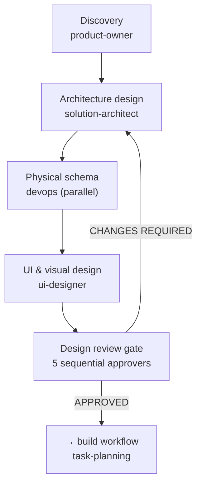

### Notes for agents

- `@product-owner` owns discovery in two modes: interview into `discovery-notes.md`, then formalise into `requirements.md` + `user-stories.md`.
- `@solution-architect` owns `architecture.md`, `api-catalogue.md`, and the canonical `artefacts/architecture/openapi.yaml`; complex components get a design doc at `artefacts/design/{component-name}.md` meeting the `design_doc_standard` (purpose, data flow, decisions, interfaces — no standards repetition).
- `design-contracts` (`@devops`, physical schema) runs **parallel** to the rest and its outputs are **disjoint** from the architect's; log each agent's output scope in HANDOFF.md before spawning.
- The review gate is strictly ordered: tech-lead → code-reviewer → principles-reviewer → ui-designer → security-tester. CHANGES REQUIRED returns to the appropriate design phase; architecture blockers = 0 is the criterion.
- Entry: run when requirements are missing or when UI/UX or architecture needs review **before** implementation. Exit: APPROVED design → `build`.


### full-test.yaml

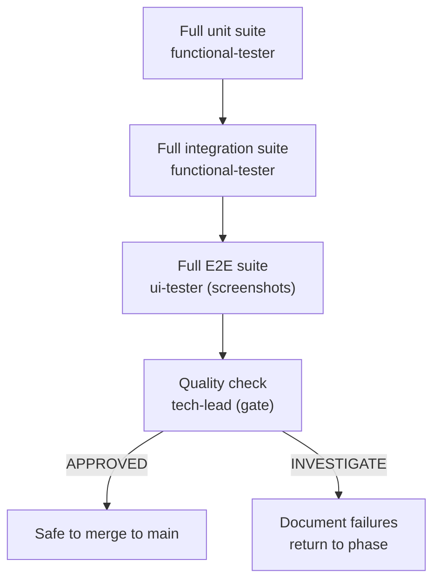

### Notes for agents

- No code changes in this workflow — failures are **reported**, not fixed (fixes belong to the sprint). Report flaky tests separately from genuine failures.
- Run after the final sprint-review of a feature (before merging to main) or on demand to verify system health. It is NOT the per-feature regression (that is `build.yaml`, scoped to changed modules).
- Thresholds at the quality gate: 100% pass rate on all three suites; ≥95% coverage on changed feature modules; ≥80% baseline elsewhere.
- E2E requires at least one screenshot per workflow in `artefacts/test-results/e2e/screenshots/`, and the log must show browser interactions, not just API calls.


## prototype.yaml

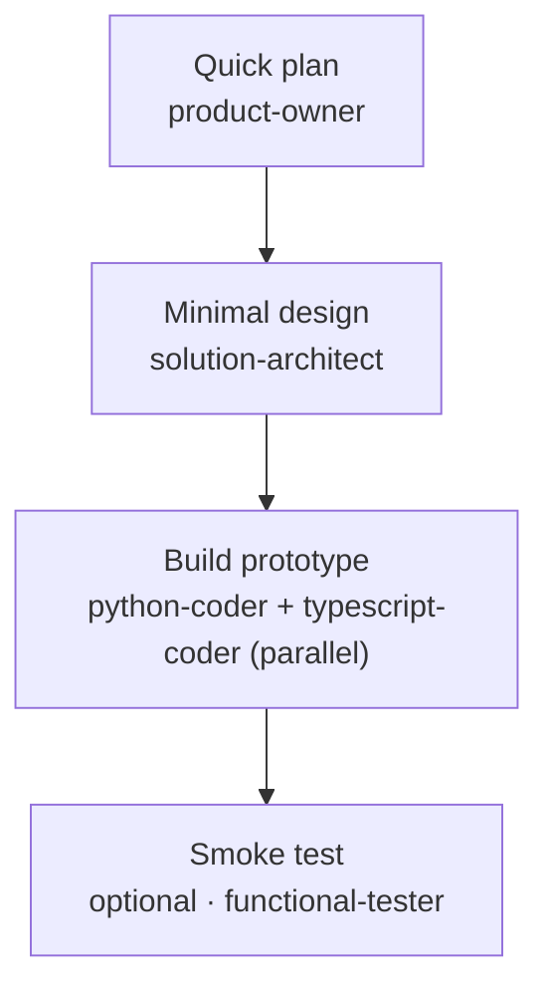

### Notes for agents

- Prototype code must NOT go to production. No quality gates exist — review before promoting.
- Speed over quality: no formal reviews, documentation optional, tests optional (happy-path smoke only), skip deployment infrastructure. Technical debt is acceptable and expected.
- Keep `requirements.md` lightweight — document the core hypothesis, not a spec; `architecture.md` high-level key decisions only, no detailed API specs.
- Commit after each meaningful milestone — git log is the recovery point. If the prototype succeeds, rewrite with the `build` workflow.


## small-task.yaml

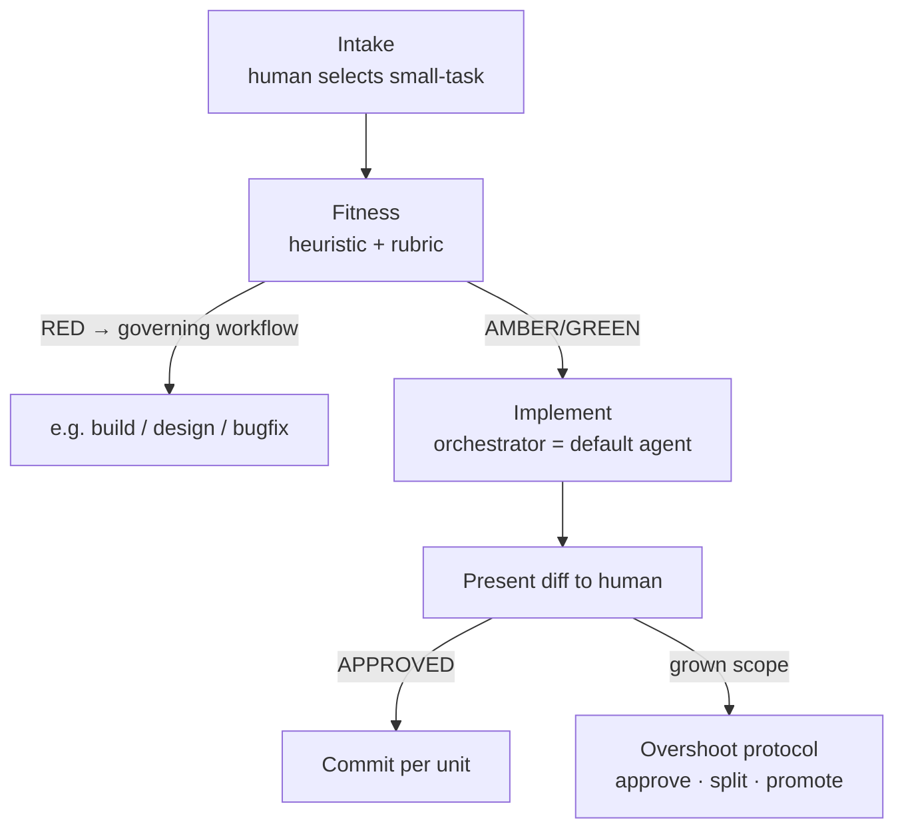

### Notes for agents

- The `@orchestrator` **is** the implementer here — the only workflow that lifts the "never authorises implementation" boundary. Do not delegate; do not spawn sub-agents; do not combine with other workflows — promotion is the sanctioned exit.
- **Skill duty**: the work type is not a discriminator — load the matching skill before implementing (python-scripting, typescript-development, database-design, technical-authoring, ui-development, git-subrepo-operations, …). If no skill/standard/rule covers the dominant work class, surface the harness gap — do not improvise.
- **Fitness pre-flight**: run heuristics H1–H8 (any RED → governing workflow unless the human overrides, recorded in HANDOFF.md), then weigh rubric R1–R7 with the human. When unsure, default heavier.
- **Overshoot protocol**: pause and let the human choose approve-grown-scope, split into logical units, or promote (transfer package: HANDOFF.md + `tasks-<branch>.md` stub). Never discard the working tree; never spawn cold.
- Human approval is the gate and cannot be waived — present the diff, obtain an explicit APPROVED verdict, then commit.